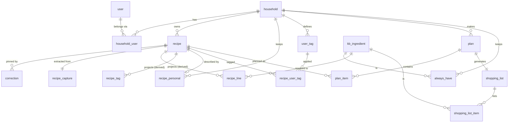

# V0.1 data model

Resolves [Design the V0.1 data model](https://github.com/Ed-Barnes937/FindersEaters/issues/13). Feeds the V0.1 spec (`docs/spec/v0.1.md`). Builds on `docs/spec/engine-pipeline.md`, `docs/spec/food-knowledge-base.md`, `docs/spec/query-model.md`, `docs/spec/search-and-library.md`, `docs/spec/suggestion-scoring.md` and the shopping list prototype ([Prototype the shopping list in the shop](https://github.com/Ed-Barnes937/FindersEaters/issues/16)).

Every decision here was made by the agent under the owner's standing rules. None was escalated: the one-way-door parts (household ownership, recipe-per-household, correction anchors) were already settled upstream, and the rest is either regenerable or an additive migration. Column names are indicative; Drizzle schema names follow them.

## 1. Shape in one paragraph

Data falls into two classes. **Durable** data is what the household gave or decided and cannot be recomputed: the original text, provenance, corrections, the personal layer, plans, plan items, shopping list ticks, always-haves, households and users. **Derived** data is everything the engine or the knowledge base build produces: engine output, effective tags, resolved ingredient lines, needs-review, the knowledge base itself. Durable data is fully relational and carefully shaped, because that shape is what migrations cost. Derived data is stored for speed but always rebuildable from durable data plus the engine and KB versions, so its shape can change with a re-parse instead of a data migration. Engine output is stored as one JSON document per recipe, with a few relational **projections** beside it for what cross-recipe queries need.

## 2. Conventions

- **Ids** are UUIDv7, generated by the app. The client may supply the id on create, so a persisted paused mutation replayed after a reconnect is an idempotent insert (`ON CONFLICT DO NOTHING`). Knowledge base ingredients use UUIDs too, minted once by the KB build and kept stable across rebuilds (an id map in the own layer), so household-local ingredients can later share the same id space.
- **Ownership.** Every durable row carries `household_id` directly or through exactly one parent FK. Every read is scoped by household in the data-access layer, and a test asserts that every household-owned table is filtered. No Postgres row-level security in V0.1.
- **Times** are `timestamptz`. **Plan dates** are `date` (a local calendar day, not an instant). "Today" is computed in the household's timezone.
- **Audit.** Rows a person creates carry `created_by` (user, nullable for system writes), so shared households later can say who did what without a migration.
- **Revisions.** Recipes and plans carry an integer `revision`, bumped on every write, for compare-and-set (section 4.5) and staleness fingerprints (section 7).

## 3. Ownership: households and users

| Table | Columns | Notes |
|---|---|---|
| `household` | id, name, default_servings (int, default 2), timezone (default `Europe/London`), units (default `uk_metric`, one value in V0.1), created_at | Owns everything below. |
| `user` | id, email, name, created_at | Shape owned by the auth library chosen in [Decide auth, sign-in and import tokens](https://github.com/Ed-Barnes937/FindersEaters/issues/20), along with its session and account tables. |
| `household_user` | household_id, user_id, created_at; PK (household_id, user_id); unique (user_id) | A join table, not a column on `user`. V0.1 enforces one household per user with the unique index; household sharing adds rows, and dropping the unique index is the only change if a user ever needs two households. |

Import tokens belong to the household and are specified by the auth ticket.

## 4. Recipes

### 4.1 The recipe row

| Group | Columns | Class |
|---|---|---|
| Identity | id, household_id, created_by, created_at, updated_at, deleted_at, revision | durable |
| Original text | `source` (JSON: the source document from engine pipeline section 2) | durable, immutable |
| Provenance | provenance_kind (`url`, `book`, `own`), url, site_name, book_title, book_page (text, so "112-113" works), image_url | durable |
| Engine run | `output` (JSON, see 4.2), engine_version, kb_version, run_status (`complete`, `partial`), ran_at | derived |
| Projected facts | title, title_sort, total_minutes (nullable), yield_kind (`serves`, `makes`, null), servings (nullable), unit_system, needs_review (bool) | derived |

- **The original text never changes.** A database trigger rejects any update to `source`. A typo in it is fixed by a correction (title is a correctable field), never by editing the text, because corrections are anchored to it.
- **Provenance is separate from the source document**: the source document is engine input; provenance is display and later filtering (`from:`, `book:`). The image URL and site name are captured now and unused in V0.1. A book is free text; promoting books to an entity later is a migration over distinct titles.
- **Projected facts** are copied out of the output so the library list, sort and query never open the JSON: `title_sort` is the lowercased effective title without a leading article, for A to Z; `total_minutes` serves `time:` and the Quickest/Longest sorts.
- **Duplicate lookup**: a non-unique index on `(household_id, url)` serves the import's duplicate check (`docs/spec/import-capture.md` section 5).
- **The stored capture**: each imported recipe has one durable `recipe_capture` row (recipe_id PK and FK, route, client, requested and final URL, HTML origin, HTTP status, trimmed gzip HTML, extractor version, report JSON), defined in `docs/spec/import-capture.md` section 7. It is evidence only and never rewrites the original text.

### 4.2 Engine output: one JSON document

`output` holds the **effective output**: since corrections are pins fed into the engine, what it produces already has them applied. It contains, per engine pipeline spec: lines in original order with their role, parts, kind, extracted fields, `optional` mark, resolution (ingredient id and `exact`/`parent`/`unresolved`), canonical amount (min/max or two-measure expression), offsets for highlighting; recipe-level facts (yield kind, servings, total time, unit system, tags); every decided value with its source (`correction`, `rule`, `model`, `derived`), and for Clef decisions the confidence and top three alternatives; and the flags (target, code, severity, the engine's answer, alternatives), including `orphaned_correction` flags.

Why JSON and not tables: only the current output is kept, it is regenerable, and its shape is versioned by the engine version. A new field or a reshaped stage is a re-parse, not a migration. The recipe view and the review screen each read one recipe's whole output, which a document serves in one read. The zod type for the document lives in the engine package and is the contract.

### 4.3 Projections for cross-recipe queries

Written from `output` by one function, in the same transaction as the output, and rebuildable from it at any time.

| Table | Columns | Used by |
|---|---|---|
| `recipe_tag` | recipe_id, dimension, value, source; PK (recipe_id, dimension, value); index (dimension, value) | Dimension predicates, filter-sheet value counts (an indexed `GROUP BY` joined to the household's recipes), scoring's tag inputs. Holds effective tags, including implied diet tags. |
| `recipe_line` | recipe_id, line_index, part_index, kind, ingredient_id (nullable), resolution (`exact`, `parent`, `unresolved`, null), optional, name_normalised; PK (recipe_id, line_index, part_index); index (ingredient_id) | `ing:` (quantified and unquantified lines that resolved), scoring's ingredient sets, the KB gap list (unresolved and parent lines grouped by `name_normalised`). |

`needs_review` on the recipe row is true when the output has a `check` flag. Pinned decisions are never flagged and a correction clears its target's flag, so this is exactly "a `check` flag whose target has no correction".

Shopping list generation reads the `output` documents of the plan's recipes directly (a plan has a handful), so amounts are not projected.

### 4.4 Corrections

| Column | Notes |
|---|---|
| id, recipe_id, created_by, created_at, updated_at | |
| scope | `line` or `recipe` |
| line_index, part_index, line_hash | Line scope only. The anchor from engine pipeline section 6. |
| field | `role`, `split`, `kind`, `quantity`, `unit`, `ingredient`, `prep`, ... for lines; `title`, `servings`, `total_time`, `unit_system`, or `tag:<dimension>:<value>` for the recipe. |
| value | JSON: the whole replacement value (an ingredient id, a quantity with its range, a tag `add` or `remove`). |
| intent | `change` or `confirm`. A confirmation stores the engine's own value; `confirm` marks it as a golden-set candidate. |

- Unique on (recipe_id, scope, line_index, part_index, field), with nulls not distinct. A second correction to the same target replaces the first. No correction history is kept.
- **Orphaned is not stored.** Whether a correction applies is a fact of each engine run, so it lives in the output as an `orphaned_correction` flag. The correction row is never deleted by the engine. The user deletes it by resolving the flag (re-pointing it, or discarding it).
- Ingredient ids inside `value` have no FK (they are JSON). Retired ingredients are followed through `replaced_by` at run time, as the KB spec says.

### 4.5 Writing a recipe

- **Import** inserts the recipe with `source` and provenance first, then runs the engine and writes output plus projections. Nothing the user gave is lost if the engine fails.
- **Every output write** (import, correction rerun, lazy completion, re-parse, re-resolution) updates `output`, the projected facts, both projections and `needs_review` in one transaction, guarded by compare-and-set on `revision`. A correction bumps `revision` in its own transaction and reruns the deterministic stages under a row lock. A lazy completion or batch re-parse computes outside a transaction (Clef calls are slow) and writes only if `revision` is unchanged; otherwise it retries from the new state. Two people correcting at once, or a correction racing a lazy completion, can therefore never write an output computed from stale corrections.
- **Staleness** is `engine_version` or `kb_version` differing from the running engine's, checked on read (lazy) and by the batch command.

### 4.6 Deleting a recipe

Soft delete: `deleted_at` is set. A deleted recipe leaves the library, search and the planner's candidate pool, but its plan items stay, so plan history and "last cooked" stay true and past plans still show what was eaten (the title from the stored output). Deleting a recipe that has plan items dated today or later, or undated in the current plan, asks first and removes those items, which regenerates the shopping list. Undo is clearing `deleted_at`. Nothing is hard-deleted in V0.1 except by deleting the household.

## 5. Personal layer

Household facts about a recipe, keyed by (household, recipe) even though every recipe is household-owned today, so that a recipe a household did not author (a shared or stock recipe, if one ever exists) can still carry them.

| Table | Columns | Notes |
|---|---|---|
| `recipe_personal` | household_id, recipe_id, favourite (bool), rating (smallint, null), notes (text, null), updated_at; PK (household_id, recipe_id) | Rating and notes are structure only in V0.1 (no UI). Row created lazily. |
| `user_tag` | id, household_id, name; unique (household_id, lower(name)) | |
| `recipe_user_tag` | recipe_id, user_tag_id; PK both | |

**Times cooked and last cooked are not stored.** They are derived from cookings (section 6.3).

## 6. Plans

### 6.1 Plans and plan items

| Table | Columns | Notes |
|---|---|---|
| `plan` | id, household_id, created_by, created_at, starts_on (date, null), ends_on (date, null), revision | A household has many plans. The optional range lets the planner show empty days and default the suggestion count; item dates are not constrained to it. |
| `plan_item` | id, plan_id, household_id, recipe_id, servings (int, null), date (date, null), position (int), created_by, created_at, updated_at; index (household_id, recipe_id, date) | Exactly the shape from [Decide whether a plan item is one recipe or a meal](https://github.com/Ed-Barnes937/FindersEaters/issues/3): no meal, no slot, no kind. `household_id` is denormalised for the cooking queries. `position` orders items within a date and within the unscheduled group. |

- **Servings** is the amount in the recipe's yield kind: people for a `serves` recipe, items for a `makes` recipe. It defaults to the household's default servings for a `serves` recipe with known servings. **Null means "as written"** (scale factor 1), the default for a `makes` recipe or one with unknown servings. The scaling rules themselves are the scaling ticket's.
- **The current plan** is the household's most recently created plan. The Plan and Shop tabs open it. Starting a new plan makes it current; older plans stay as history. This is a derived pointer, not a column, so the plan prototype can change the rule freely.
- **Deleting a plan** hard-deletes its items and shopping list, and with them those cookings. That is the household's call to make.

### 6.2 Discrete plans, not one rolling timeline

Considered: a single rolling plan per household (a dated timeline plus an undated backlog, with "this week" as a date window). Rejected for V0.1 because the scoring spec, shopping list and prototype all reason about "this plan" as a set ("not already in this plan", "cookings excluding this plan", one shopping list per plan), and a shopping list over a date window plus a hand-picked part of a backlog is harder to explain. Reversible: items carry their own dates, and cooking history does not depend on plan boundaries, so moving to a timeline later means treating plans as groupings.

### 6.3 Cookings: where "last cooked" comes from

**A dated plan item is a cooking on its date**, past or future, in any plan. There is no explicit "cooked it" mark in V0.1.

- Last cooked = the latest cooking dated today or earlier. Times cooked = the count of those. Both are derived by query (a view over `plan_item` joined to non-deleted plans), never stored.
- The planner's cooking dates are every cooking of the recipe outside the current request's plan, past and future.
- `cooked:<14d` compiles to an `EXISTS` over cookings in the window; `cooked:never` to no cooking dated today or earlier.
- Scenarios: chilli planned Monday and actually cooked Thursday: the household drags the item to Thursday (or not, and history is off by three days, which the 28-day gap absorbs). Cooked something off-plan: add it to the plan with a past date. Planned but never cooked: delete the item. An undated item is never a cooking.
- Why no mark: it costs a tap per meal that nobody will make reliably, and the scoring only needs dates to within a week or so. If plan history proves too noisy for learned cadence later, a nullable `cooked` state on `plan_item` is an additive column.

## 7. Shopping lists and always-haves

| Table | Columns | Notes |
|---|---|---|
| `always_have` | household_id, ingredient_id, created_at; PK both | Knowledge base ingredients only. How an always-have matches lines through the hierarchy is the merge ticket's. |
| `shopping_list` | id, plan_id (unique), household_id, generated_at, inputs_fingerprint | One list per plan, materialised (ticks must persist, increases must be detectable, the phone needs a snapshot offline). |
| `shopping_list_item` | list_id, item_key, ingredient_id (null), aisle, amounts (JSON: the merged amount and source lines as last generated), always_have (bool), ticked (bool), ticked_at_device (timestamptz, null), ticked_by (user, null), increased_from (JSON, null); PK (list_id, item_key) | |

- **`item_key`** identifies an entry across regenerations: the ingredient id for a resolved ingredient, and a key built from the recipe and line anchor for an unresolved line (never merged). Its exact format, merging, rounding and aisle mapping are [Define shopping list merge and regeneration rules](https://github.com/Ed-Barnes937/FindersEaters/issues/23)'s.
- **Regeneration** upserts by `item_key`, keeps `ticked`, compares the new amounts with the stored `amounts` to set `increased_from` and untick on an increase, and deletes entries no longer needed. It runs eagerly after a plan edit, and on read when `inputs_fingerprint` (plan revision, the plan's recipe revisions, the always-have set) no longer matches, which covers a correction or re-parse of a recipe in the plan.
- **Ticks**: a tick write carries the device time; the server applies it only when its device time is later than the stored `ticked_at_device` (later tick wins, from the prototype). At home vs In the basket is derived from `always_have` and `ticked`.
- Past plans keep their lists. They are small and show what was bought.

## 8. Knowledge base references

The knowledge base is the `kb` schema, written by the KB build (shape in `docs/spec/food-knowledge-base.md`: ingredient with id, slug, slug aliases, OFF id, retired and `replaced_by`; names; "is a" and "made from" edges; facts with source; measures; packs; aisles), plus `kb.ancestor` (node, ancestor) over "is a" only, including self, rebuilt by each load.

- Durable and derived rows reference `kb.ingredient(id)` with real foreign keys (`always_have`, `recipe_line`, `shopping_list_item`). This makes the KB rule "never deleted while referenced" enforced by the database, and so **the KB load must upsert and retire, never truncate and reload**.
- Ingredient ids inside correction values and engine output are JSON and checked by the engine at run time instead.

## 9. Room for the foundations (no migration rewrite)

| ⚑ Foundation or later feature | Where it lands |
|---|---|
| Household ownership and sharing | Already the owner of every row. Sharing adds `household_user` rows (and a role column when the sharing UX defines roles). `created_by` is already recorded. |
| Household members (people who eat) | New `member` table under the household, plus a `plan_item_eater` join when "who's eating" arrives. Plan items keep storing servings directly, so members derive a default, never replace it. Per-member likes are a new table beside `recipe_personal`. |
| Sub-recipes and components | A line's resolution target widens from ingredient to ingredient or recipe: a new outcome in the output document (a re-parse, no migration), a nullable `sub_recipe_id` on `recipe_line`, and a recipe-id correction value. The shopping list expands sub-recipes recursively with a cycle guard. Sections ("For the sauce") already exist as header lines. |
| Ingredient hierarchy | Already the `kb` edges and ancestor closure. Household-local ingredients share the UUID id space: a nullable `household_id` on `kb.ingredient` or a sibling table, additive either way. |
| Personal layer for non-authored recipes | Already keyed by (household, recipe). |
| Collections and rules | `collection` (household, name, query JSON with its `v`), `rule` (plan or household, query JSON, min, max). New tables. |
| Dismiss with a reason ("never") | A nullable `dismissed_at` on `recipe_personal`, read by the hard layer. |
| Learned cadence | Computed from cookings; nothing new stored. |
| Leftovers or eating out as plan items | A `kind` column on `plan_item` defaulting to `recipe`, with `recipe_id` made nullable for other kinds. |
| Meal grouping | A nullable `group_id` on `plan_item`; today's rows read as each item its own group. |
| Explicit cooked mark | A nullable state on `plan_item`. |
| Recipe images | `image_url` is already captured. A stored copy would add an asset table. |
| Semantic search | A `recipe_embedding` table with pgvector (Neon has it), derived like the projections. |
| Free-text shopping extras | Rows in `shopping_list_item` with a `manual` key prefix that regeneration leaves alone. |

## 10. Entity overview

## 11. Hand-offs

- **[Decide auth, sign-in and import tokens](https://github.com/Ed-Barnes937/FindersEaters/issues/20)**: `user` and session tables come from the auth library; households link through `household_user` (one household per user in V0.1). Every request resolves to the user's single household row.
- **[Define shopping list merge and regeneration rules](https://github.com/Ed-Barnes937/FindersEaters/issues/23)**: the `item_key` format (including unresolved lines and a recipe appearing in two plan items), what `amounts` holds, the fingerprint inputs, and how always-haves match through the hierarchy, against the tables in section 7.
- **[Prototype building a plan with suggestions](https://github.com/Ed-Barnes937/FindersEaters/issues/15)**: plans are discrete with an optional date range; the current plan is the most recently created; what happens to a finished plan's undated items when a new plan starts (recommend: offer to move them) is the prototype's call.
- **[Prototype reviewing and correcting a parsed recipe](https://github.com/Ed-Barnes937/FindersEaters/issues/14)**: corrections carry `intent` (`change` or `confirm`); resolving an orphaned correction means re-pointing or discarding it.
- **[Define deploy, migration and backup operations](https://github.com/Ed-Barnes937/FindersEaters/issues/21)**: the KB load is upsert-and-retire because of the foreign keys; the projections and `needs_review` can be rebuilt from `output` by a command; durable tables are what backups must protect.
- **Scaling (map fog)**: plan item servings are in the recipe's yield kind and null means as written.
- **[Write the Claude Design brief](https://github.com/Ed-Barnes937/FindersEaters/issues/17)**: deleting a recipe asks before removing its upcoming plan items; past plans show deleted recipes by title.
